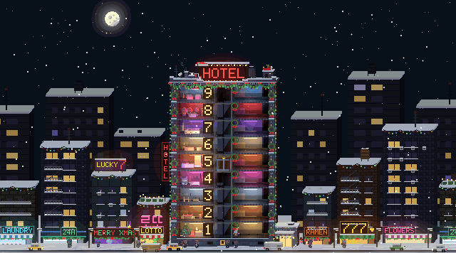
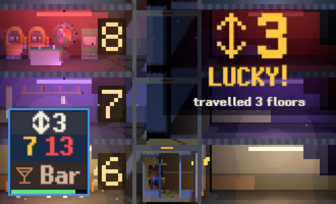
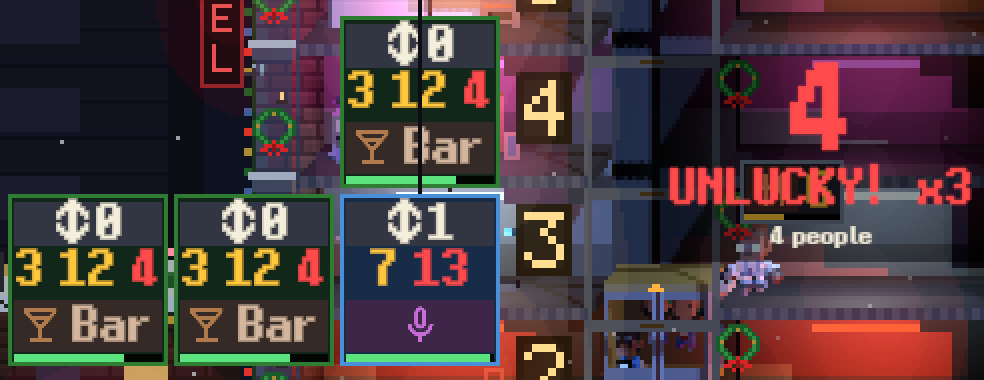
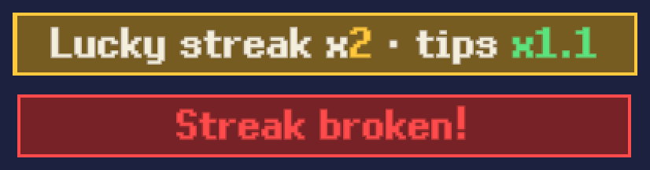
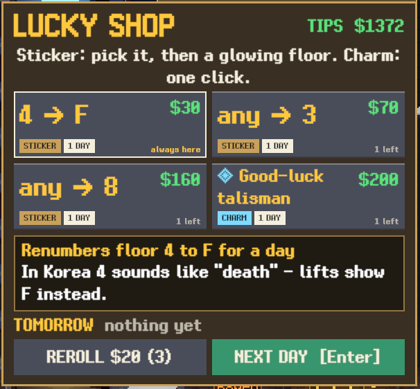
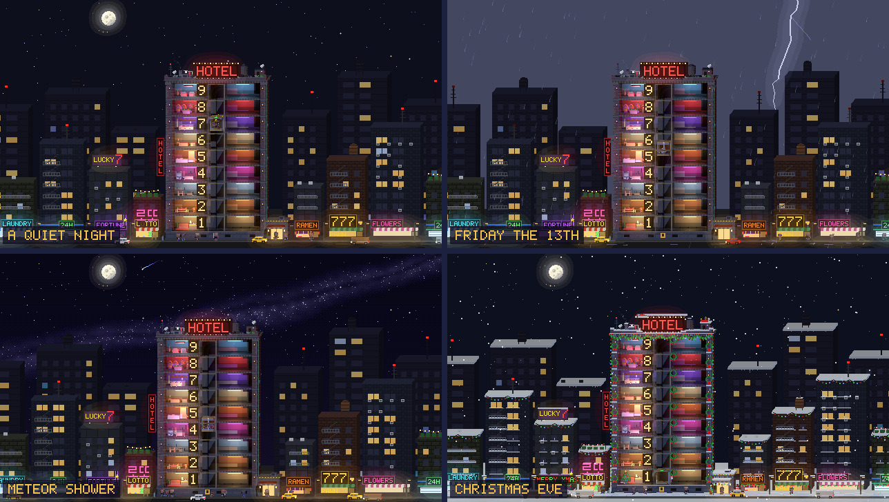
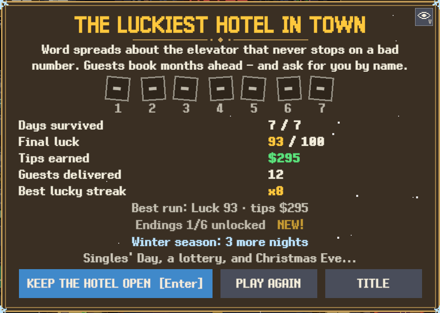
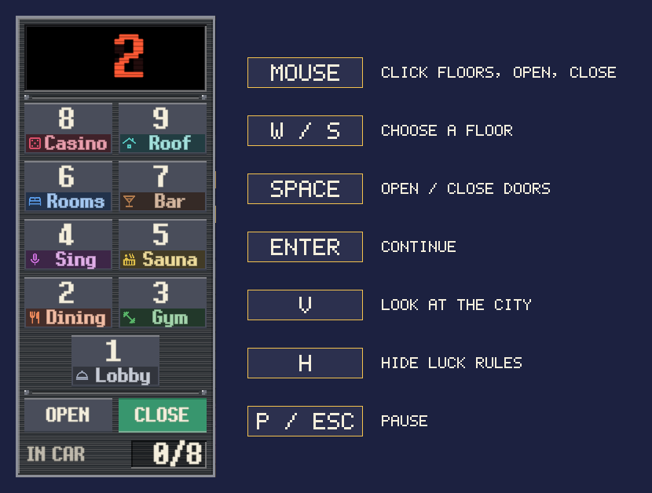
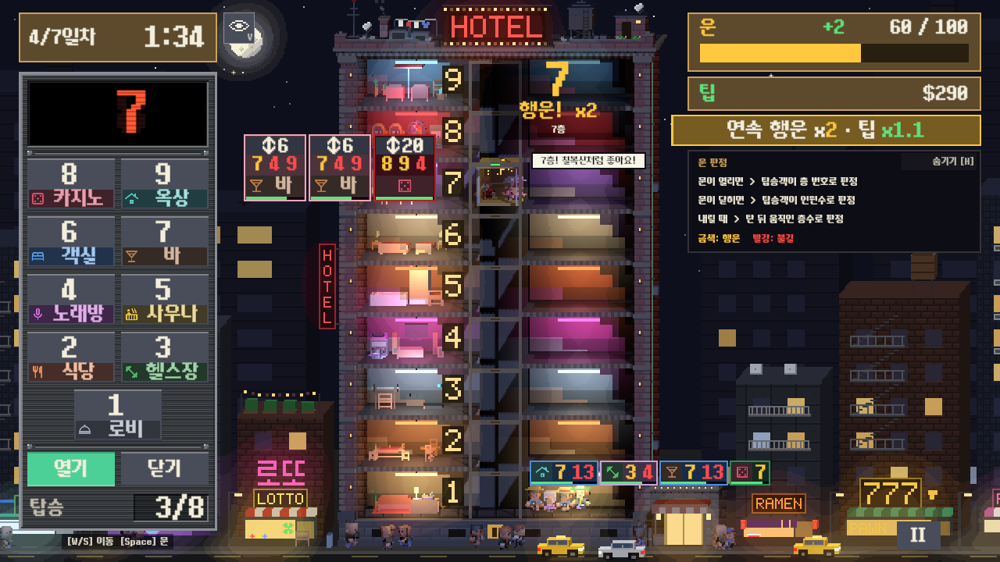

<p align="center">
  
</p>

<p align="center">
  <b>Every guest has a lucky number. Every guest has a number they fear. You run the elevator.</b>
</p>

<p align="center">
  <a href="https://naul-ds.itch.io/floor-f"></a>
  
  
  
</p>

<p align="center">
  
</p>

---

## About

Say "lucky number" and most people think of **7**. But a number's meaning changes with every border and every faith:
**4** sounds like "death" in Korean, Chinese and Japanese, **8** sounds like "fortune" in Chinese, a devout priest flinches
at **6**, and **13** is a curse in the West but a blessing to an Italian grandpa, who fears **17** instead.
Same elevator, same buttons, a different meaning for every guest.

You are the night-shift elevator operator of a small city hotel. Get every guest where they're going, keep them happy,
and keep the hotel's **Luck** from running out.

**[▶ Play Floor F in your browser on itch.io](https://naul-ds.itch.io/floor-f)** (about 30 minutes, keyboard + mouse, English / 한국어)

## How luck works

Every number in the car counts:

| When | Who judges | What they judge |
|---|---|---|
| **Doors OPEN** on a floor | everyone inside | that floor's number |
| **Doors CLOSE** | everyone inside | how many people are riding |
| **Stepping OUT** | the guest leaving | how many floors they travelled (detours count!) |

Each guest's tag shows their numbers: **gold is lucky, red is unlucky.**

<table>
  <tr>
    <td width="50%"></td>
    <td width="50%"></td>
  </tr>
  <tr>
    <td align="center"><i>This guest loves 3 and stepped out after exactly 3 floors. Lucky!</i></td>
    <td align="center"><i>Four people in the car, and three of them fear 4. Unlucky x3.</i></td>
  </tr>
</table>

<p align="center"></p>

Lucky moments in a row build a **streak** that multiplies your tips; one unlucky moment breaks it.
Luck at 0 means the hotel is haunted.

## Bend the numbers



Between shifts, spend your tips in the **Lucky Shop**:

- **Stickers** relabel a floor for a day. A 4th floor nobody fears is just floor **"F"**.
  Turn any floor into a 7, an 8, a 3...
- **Charms** help for one day: a talisman that blocks one unlucky moment, ginseng tea for impatient guests,
  a beckoning cat for bigger tips.

<br clear="right">

## Ten nights, six endings

A training shift, then seven nights, each with its own twist: business hours, a honeymoon, a full house,
Friday the 13th in the rain, a double wedding, a meteor shower. Finish the season well and the hotel stays open for
winter: Singles' Day, a lottery night, and Christmas Eve.

<p align="center"></p>

**6 endings** to discover, one of them hidden. Who is the hooded guest who loves the number 4?

<p align="center"></p>

## Controls



| Input | Action |
|---|---|
| Mouse | floor buttons, OPEN / CLOSE on the panel |
| `W` / `S` | choose a floor |
| `Space` | open / close the doors |
| `Enter` | continue |
| `V` | look at the whole city |
| `H` | hide the luck rules |
| `P` / `Esc` | pause |

Korean / English: **OPTIONS** on the title screen.

**Tips**
- Read the numbers above each guest's head before you open the doors.
- The fastest route is not always the luckiest one.
- The **IN CAR** count turns gold or red *before* you close the doors.

<br clear="right">

## Under the hood

- **Unity 6000.6.8f1**, URP, Input System, uGUI + TextMeshPro, built for **WebGL**.
- Low-poly 3D rendered at **640×360** through a pixel shader, then scaled up with nearest-neighbour filtering.
  The hotel, the city skyline, weather (rain, lightning, snow, meteor showers) and lighting are all procedural.
- Thunder, rain, bells and the winter music box are **synthesized in code** at runtime.
- Rules live in a pure C# core (`FloorF.Core`, no engine references) and are covered by EditMode tests;
  presentation modules talk to it only through events and interfaces.

```
Assets/_Project/
├─ Scripts/
│  ├─ Core/        rules, simulation, luck judgement, shop economy (pure C#)
│  ├─ Gameplay/    elevator + guest behaviour, input, session flow
│  ├─ Rendering/   pixel pipeline, procedural hotel / city / weather, camera
│  ├─ UI/          HUD, elevator panel, speech bubbles, shop, endings
│  ├─ Audio/       mixer, cues, procedural synth (thunder, bells, music box)
│  └─ Editor/      builders for scenes, prefabs and data assets
├─ Resources/Data/ guests.json, days.json, stickers.json, hotel.json
└─ Tests/          EditMode (rules) + PlayMode (runtime, screen captures)
```

**Run it locally:** open the folder in Unity **6000.6.8f1**, open `Assets/_Project/Scenes/Main.unity`, press Play.
**Build:** File → Build Profiles → Web.

## Credits

Made solo for the **Official 2026 Unity Game Jam** (theme: *Lucky Number*) by **Naul_ds**.

| Asset | Author | License |
|---|---|---|
| Music: "Local Forecast - Elevator" | Kevin MacLeod ([incompetech.com](https://incompetech.com)) | [CC BY 4.0](https://creativecommons.org/licenses/by/4.0/) |
| 3D models and sounds: Mini Characters, Furniture Kit, Mini Arcade, Interface Sounds, Casino Audio | [Kenney](https://www.kenney.nl) | CC0 |
| Sounds | Freesound: LilMati, PagDev, LaurenPonder, egomassive, danlucaz, BlondPanda | CC0 |
| Fonts: Mulmaru | mushsooni | SIL OFL 1.1 |
| Fonts: Galmuri11 | Lee Minseo (quiple) | SIL OFL 1.1 |
| Icons: Material Symbols | Google | Apache 2.0 |

License texts for the bundled fonts are next to them under `Assets/_Project/ThirdParty/`.

## AI disclosure

Generative AI (**Claude**, via Claude Code) was used for nearly all of the C# code, the guest dialogue and UI text
(English / Korean), balance drafts (checked with an automated play-bot and playtests), the procedural content code,
and the scripts that composed the store-page images, GIF and trailer from in-game captures.
**No AI image, music, voice or 3D-model generators were used**; all models, music and recorded sounds are the
human-made assets credited above. Concept, design decisions, art and sound direction, playtesting and final review: Naul_ds.

<details>
<summary><b>한국어 소개</b></summary>

<br>

**모든 손님에게는 행운의 숫자가 있다. 그리고 두려워하는 숫자도. 당신은 엘리베이터를 운전한다.**

'행운의 숫자' 하면 보통 7이 떠오르죠. 하지만 숫자의 의미는 나라와 믿음마다 다릅니다. 한국·중국·일본에서 4는 '죽을 사(死)'와
발음이 같아 꺼리고, 중국에서 8은 '돈을 번다(發)'와 소리가 비슷해 사랑받습니다. 신부님은 6만 보면 움찔하고, 서양에서 13은
불길한 숫자지만 이탈리아 할아버지에게는 행운의 숫자라서 대신 17을 두려워하죠.

작은 도시 호텔의 야간 엘리베이터 안내원이 되어, 손님을 목적지까지 모시고 호텔의 운이 바닥나지 않게 하세요.

- **문이 열리면**: 안에 있는 모두가 그 층의 번호로 판정
- **문이 닫히면**: 안에 있는 모두가 탑승 인원수로 판정
- **내릴 때**: 탄 뒤 움직인 층수로 판정 (돌아가도 다 셉니다!)

근무가 끝나면 받은 팁으로 **행운 상점**에서 층 번호를 바꾸는 스티커와 부적을 사세요.
연습 근무 후 일곱 밤, 그리고 겨울 시즌의 세 밤. 숨겨진 하나를 포함해 엔딩은 6개입니다.

<p align="center"></p>

**[▶ itch.io에서 브라우저로 플레이](https://naul-ds.itch.io/floor-f)**
</details>
